<a href="https://domingoberbel.com"><picture><source media="(max-width: 600px)" srcset="./assets/header-m.svg"></picture></a>

**[domingoberbel.com](https://domingoberbel.com)** · [LinkedIn](https://linkedin.com/in/domingo-berbel) · [info@domingoberbel.com](mailto:info@domingoberbel.com)

 

 

<picture><source media="(max-width: 600px)" srcset="./assets/stack-bars-m.svg"></picture>

 

<picture><source media="(max-width: 600px)" srcset="./assets/projects-m.svg"></picture>

 

<picture><source media="(max-width: 600px)" srcset="./assets/contrib-heatmap-m.svg"></picture>

 

*Generado con Python — `python -m scripts.build_all`. El heatmap se refresca a diario.*

